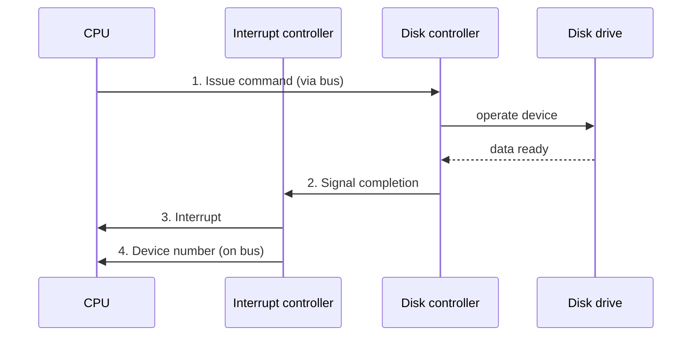

An interrupt is a signal that lets a device controller actively notify the CPU that it has finished a task, rather than forcing the CPU to repeatedly poll for completion. It is one of the three [[Device Communication Methods]], alongside busy waiting and [[Direct Memory Access]].

## How It Works

### The Interrupt Mechanism, Step by Step

Picture a CPU issuing a read command to a disk controller:

1. The CPU sends the command to the disk controller over the [[Bus]], which then operates the physical disk drive.
2. Once the requested data is ready, the disk controller signals the interrupt controller.
3. The interrupt controller actually interrupts the CPU.
4. The interrupt controller puts the specific device number on the bus, so the CPU knows exactly which device raised the interrupt, and can dispatch to the correct handler.

### From the CPU's Point of View

From the CPU's own point of view, an interrupt breaks into its normal instruction stream at an arbitrary point: it is midway through executing the current instruction and about to move to the next one, when (1) an interrupt arrives. The CPU (2) dispatches to the interrupt handler, runs that handler to completion, and then (3) returns to exactly where it left off, resuming the next instruction as though nothing had happened, apart from the time the handler took.

## Related Concepts

This hardware-level interrupt mechanism is conceptually distinct from, but related to, the software-initiated **[[System Call|trap]]** a program uses to deliberately enter [[Kernel Mode]].
