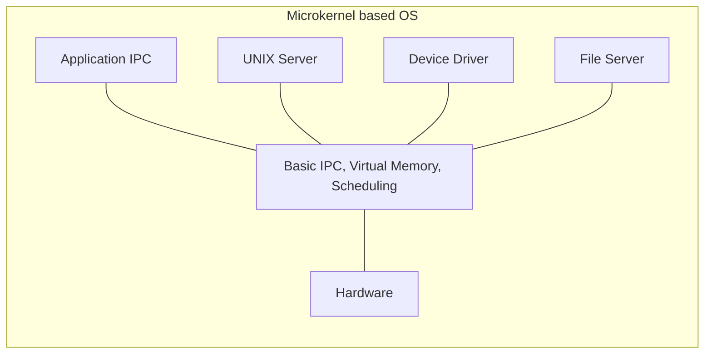

A microkernel takes the opposite approach from a [[Monolithic Kernel]] design: keep the kernel itself very small, typically just basic process and memory management plus message passing, and push every non-essential OS service out into [[User Mode]], communicating with each other and with the kernel via message passing. It is one of the main approaches to [[Operating System Structure]].

## How It Works

This gives high stability: a bug in a [[Device Driver|driver]] running as a user-mode service cannot take the entire system down. It also gives high flexibility: extending the system does not require rebuilding the kernel at all. The cost is high overhead from all that message passing between services that, in a monolithic design, could have just called each other directly.

The application, the UNIX server, device drivers, and the file server are all separate user-mode components sitting on top of a genuinely minimal kernel that provides nothing but basic IPC, virtual memory, and scheduling.

## Related Concepts

Andrew Tanenbaum, co-author of the course's textbook, was a historical advocate for the microkernel approach, as discussed in [[Monolithic Kernel]].
