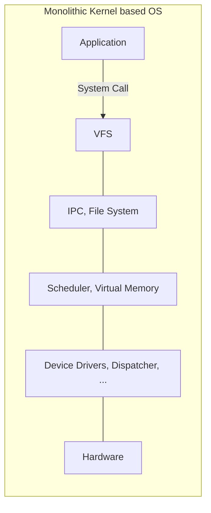

In a monolithic system, the entire operating system runs as a single program in [[Kernel Mode]], and user programs reach OS services exclusively through [[System Call]]s. It is one of the main approaches to [[Operating System Structure]].

## How It Works

The advantage is real efficiency: within the OS, every resource and service is directly accessible to every other part of it, with no expensive boundary crossings internally. The disadvantage is equally real: a bug in any one OS service can take down the entire system (a buggy [[Device Driver|audio driver]] could, in principle, accidentally write onto the disk), and the design is less flexible, since any system extension requires rebuilding the kernel itself.

Everything from the virtual file system down to the device drivers runs inside one kernel-mode block. Linux, one of the most widely deployed kernels in the world, is a monolithic design.

## A Famous Debate

The monolithic-versus-microkernel discussion is not just an academic design exercise, it has historically been a genuinely contentious debate in the field. In 1992, Andrew Tanenbaum (co-author of the textbook *Modern Operating Systems* used in this course) and Linus Torvalds (creator of Linux) publicly argued on Usenet over exactly this question, with Tanenbaum, an advocate for [[Microkernel|microkernels]], at one point suggesting Linux's monolithic design already made it obsolete. Linux, of course, went on to become one of the most widely deployed kernels in the world, monolithic design and all, a reminder that engineering trade-offs like monolithic versus microkernel rarely have a single, universally correct answer.
