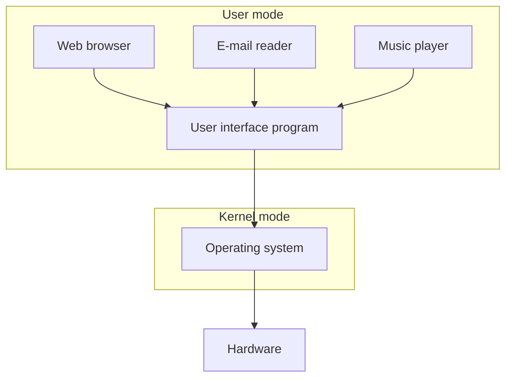
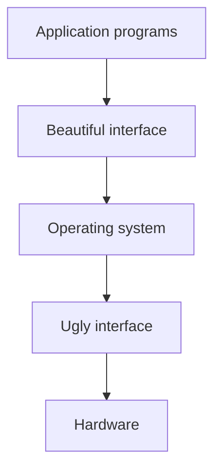

An operating system is the layer of software that sits between raw computer hardware and the application programs that people actually use. Its job, at the core, is to **manage** and **abstract** resources: it takes a genuinely messy, inconsistent hardware interface and turns it into something clean and pleasant for programs to work with.

Operating systems are everywhere, not just on desktops and servers. Windows, macOS, Linux, Unix, FreeBSD, and OpenBSD run on desktops, laptops, and servers. Android, iOS, Blackberry OS, and Symbian run on smartphones, smart watches, and smart TVs. Cisco IOS and OpenWrt run on networking devices and routers. Even tiny embedded [[Internet of Things]] devices run specialized operating systems such as Contiki OS, RIOT, OpenWSN, and TinyOS. The concept scales from a phone in your pocket down to a battery-powered sensor the size of a coin.

## How It Works

### The Layered View: Applications on Top

An operating system can be pictured as a stack of layers. Applications like a web browser, an e-mail reader, or a music player run in **[[User Mode]]**, on top of a user interface program. Beneath that, the operating system itself runs in **[[Kernel Mode]]**, and beneath that sits the raw hardware.

This user mode/kernel mode split exists to protect the stability and security of the system, and is covered in detail in the [[Kernel Mode]] and [[User Mode]] notes.

### The Abstraction View: Ugly Hardware, Beautiful Interface

The same stack can be read from the bottom up, with the emphasis on what the operating system hides rather than what sits on top of it. Hardware, by itself, is genuinely ugly: unpredictable timing, inconsistent interfaces across devices, and a mess of registers and controllers. Tanenbaum's classic textbook illustration represents this hardware layer as a row of snarling monsters. The operating system sits directly on top of that mess, and what it hands up to application programs is, by contrast, clean and pleasant to work with, represented in the same illustration as elegant figures: a princess, a castle, a peacock, a flower.

That is the operating system's whole job in a nutshell: take a genuinely nasty hardware interface and turn it into a beautiful one. Understanding what the operating system manages means first understanding what the underlying [[Computer Hardware]] actually looks like.

### Core Functions

The cover of Tanenbaum and Bos's *Modern Operating Systems* textbook doubles as a summary of the field, laying out five core functions of an operating system: processor management, memory management, security, file management, and error detection.

## Bare Metal: Systems Without an Operating System

Not every computer system runs an operating system. Running **[[Bare Metal]]** (or "bare machine") means software talks to the hardware directly with no OS layer in between at all. This is unusual for general-purpose computing but shows up in some of the smallest embedded devices, where the overhead of a full OS isn't justified.
